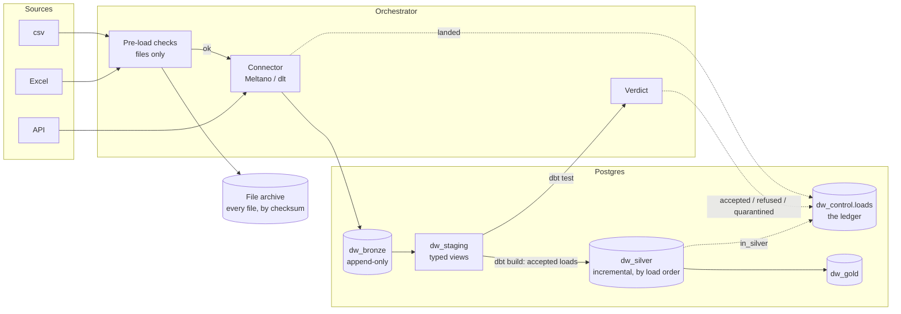
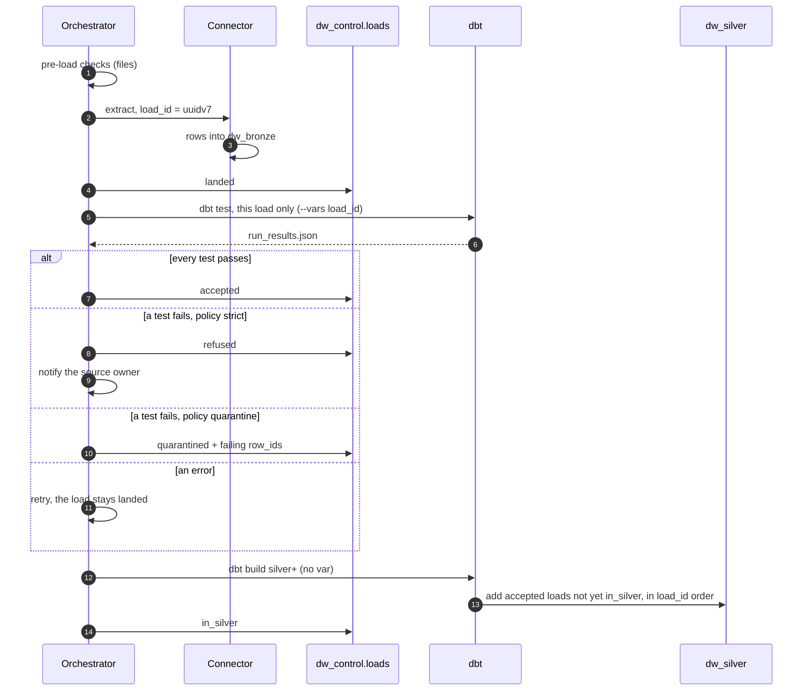
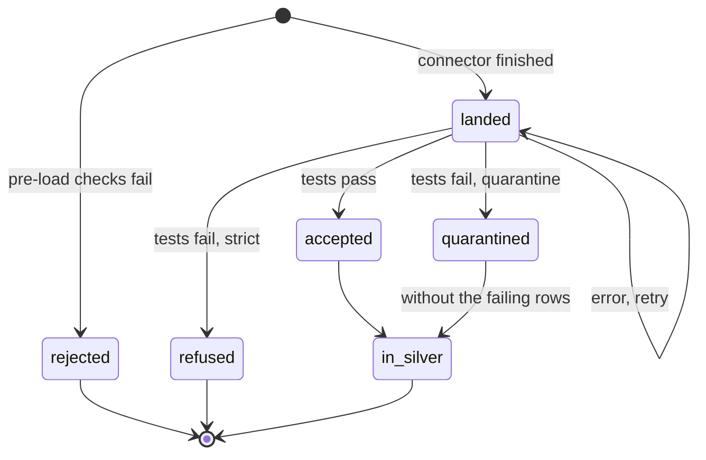
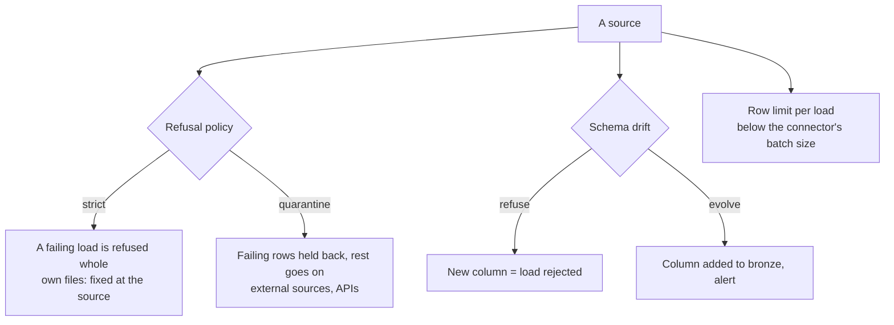
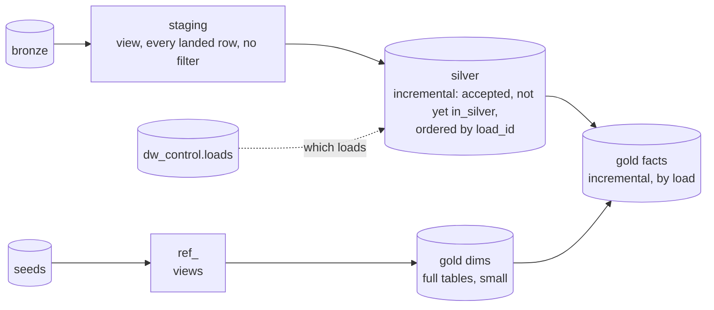
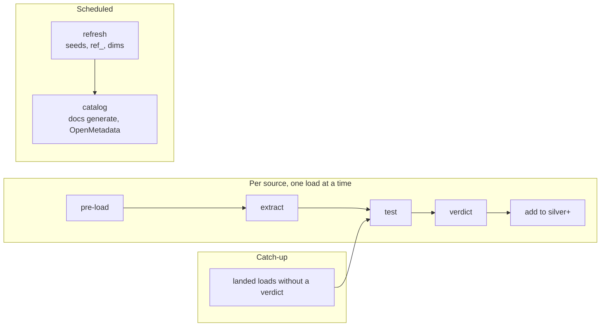
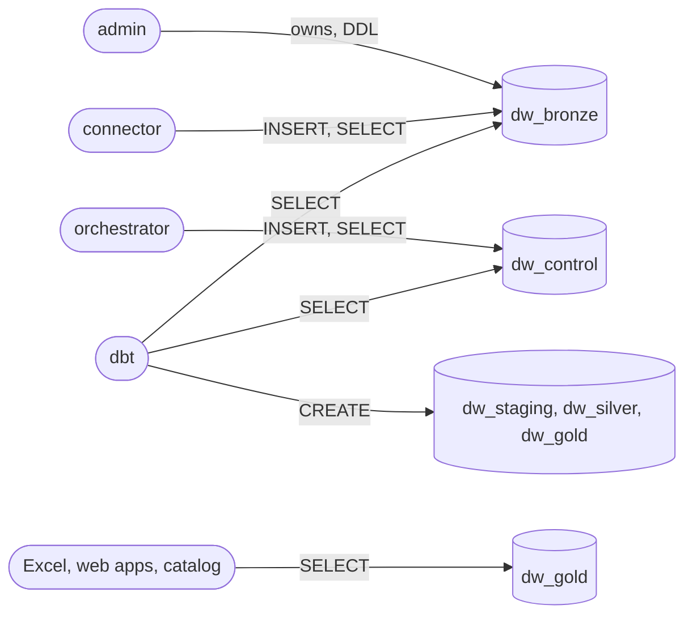
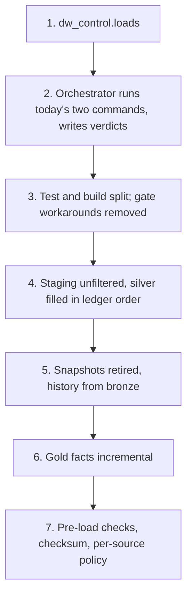

# Architecture proposal: loads without dbt as the gate

Many sources (csv, Excel, APIs), always batches. Under 10k rows per load, under 50M rows per table: Postgres stays.

**The idea:** the orchestrator owns the gate and the state. dbt transforms and tests, and holds no state.

## 1. Overview

## 2. One load

The var only filters the tests of that run. No saved object holds it.

## 3. A load's life

`accepted` = allowed into silver. `in_silver` = its rows are in silver now: new keys inserted, existing keys replaced.

One row per event in `dw_control.loads`, never updated. Not `landed` yet = invisible to dbt.

## 4. Per-source settings

## 5. dbt, stateless

- Every output = f(bronze, ledger, seeds, code).
- Silver rebuild = replay accepted loads in `load_id` order. Minutes, recovery only.
- History = the accepted versions in bronze. No snapshots.

## 6. DAGs (or jobs)

Sources run in parallel; one dataset never runs two loads at once.

## 7. Roles

## 8. What goes away

| Today | Replaced by |
|---|---|
| `load_id` var typed by hand, a build failing on purpose without it | orchestrator passes it to tests only |
| dbt skip-on-failure as the gate, `-- depends_on: ref_*` | verdict in the ledger |
| Tests reading silver from the graph | plain `ref`, test and build are separate runs |
| Staging view holding one load's id | staging over all landed rows |
| Bootstrap build, "never `seed_x+`" | scheduled refresh job |
| Silver `full_refresh: false`, not rebuildable | replay from bronze + ledger |
| Snapshots | history from bronze by load |
| Rollback by rebuilding an old id (4.2) | loads added in `load_id` order |
| Two builds at once (6.5) | one load at a time per dataset |
| Gold facts rebuilt in full per load | incremental facts |
| `aud_issues` load from `invocation_vars` | join the ledger; audit is observability only |

## 9. Migration, one step each

Each step leaves a working pipeline.

## Open decisions

- Orchestrator: Dagster (assets, blocking checks) or Airflow (most common).
- Connector: keep Meltano, or dlt (ledger built in).
- Where quarantined rows live, and who reviews them.
