# Architecture proposal: an orchestrated write-audit-publish warehouse

Any source (files, APIs, databases), any size. Nothing here assumes today's sources: a few csv files of tens of rows.

**The idea:** the orchestrator runs the pipeline and keeps its state. The ingestion tool lands data. dbt transforms
and tests, and holds no state. Every step can run again with the same result.

A **load** is one delivery from one source: a file, one API extraction, one interval of a database's changes. It has a
`load_id` (uuidv7). "Batch" is not used here: in this domain a batch is a plants batch (`docs/GLOSSARY.md`).

## 1. Principles

- **Raw first.** What a source sends is kept unchanged before anything reads it. Everything after it can be rebuilt.
- **Write, audit, publish.** A load is written, tested, and published only when its verdict allows it. The verdict is
  recorded, not inferred from what dbt skipped.
- **The orchestrator owns state.** Which loads exist, what was decided about each, what is published: one control
  table, written only by the orchestrator.
- **Idempotent steps.** Running a step twice gives the same result, so retries are on.
- **Rebuildable layers.** Silver and gold are a function of bronze, the control table, seeds and code.
- **A replaceable warehouse.** Portable SQL, so the engine follows the volume, not the other way round.

## 2. Overview

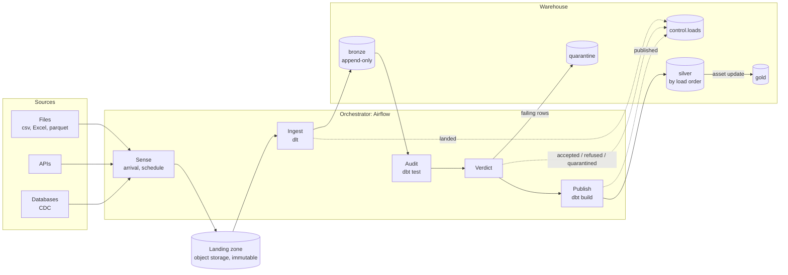

## 3. Who owns what

| Job | Owner |
|---|---|
| Schedules, arrival sensors, retries, concurrency, backfills, alerts | Airflow |
| Keeping the raw delivery, checksum, recognising a resent file | Landing zone, written by the ingest task |
| Reading a source, incremental state (cursors), bronze tables and their schema | Ingestion tool (dlt) |
| Checks on the delivery as a whole: empty, row count, header, encoding | Ingestion, before bronze |
| Checks on rows: types, ranges, references, uniqueness | dbt tests, the audit |
| The verdict of a load, and its state | Airflow, in `control.loads` |
| Typing, mapping, modeling | dbt |
| Indexes, partitioning, clustering | dbt model config, per warehouse |
| Test results, anomalies, lineage | Elementary, OpenLineage |

## 4. One load

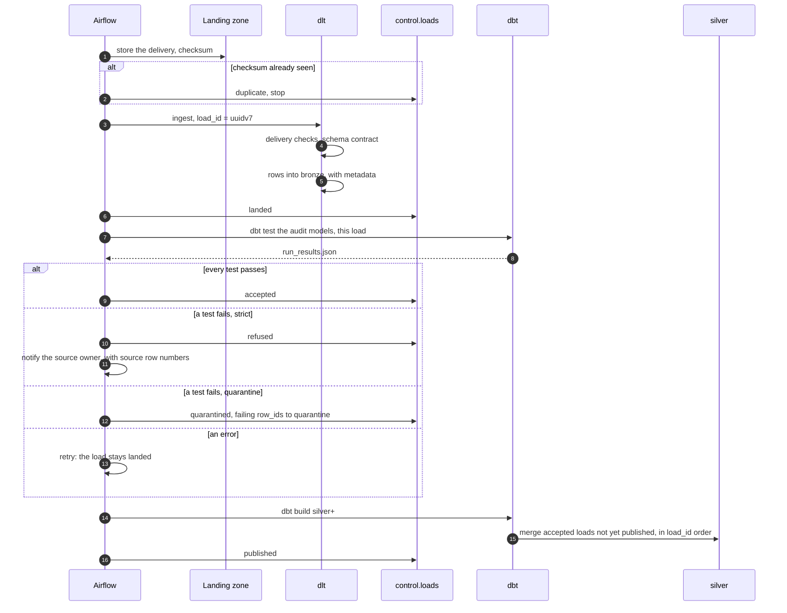

Every step reruns safely: ingestion replaces the rows of its own `load_id`, the merge is by business key, and each
state is a new row in `control.loads`.

## 5. A load's life

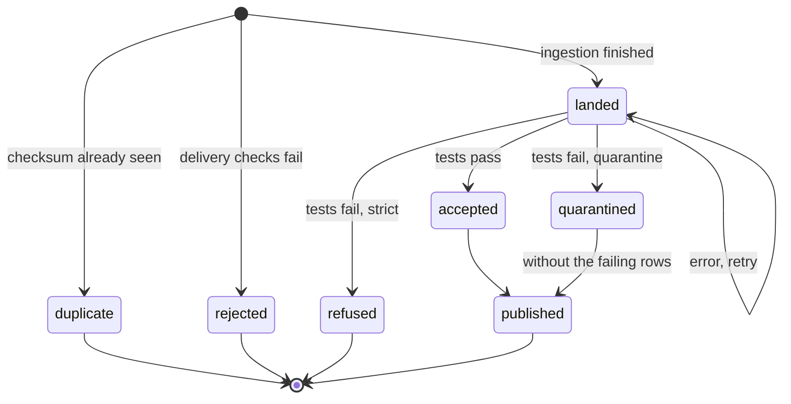

`control.loads` holds one row per event, never updated: the state of a load is its latest event. A load that is not
`landed` is invisible to dbt.

## 6. Layers

| Layer | Holds | Built by |
|---|---|---|
| Landing zone | Every delivery as received, by source, date and `load_id`, with its checksum | Ingest task |
| bronze | Rows as received, append-only, with `load_id`, `loaded_at`, `source_file`, `source_row_number` | dlt |
| audit | Typed views of bronze for the loads under audit; the tests run here | dbt |
| quarantine | Failing rows of quarantined loads, with the reason | Verdict task |
| silver | The published data, one row per business key, merged load by load | dbt, incremental |
| gold | Facts and dimensions | dbt, incremental, triggered by silver |

`source_row_number` is what the source owner needs to fix a refused file: the line, not only the value.

History comes from bronze: every published version of a row is a load in bronze. No snapshots.

## 7. Per-source settings

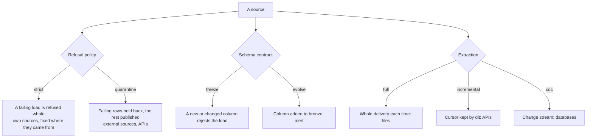

Settings live with the source's ingestion config, one place per source.

## 8. dbt, stateless

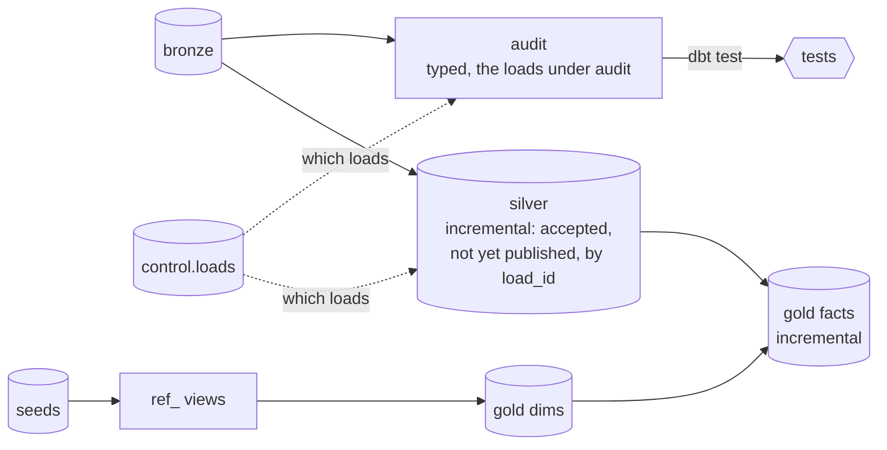

- The load under audit comes from the control table or a var passed to `dbt test` only. No view holds a `load_id`.
- Audit and publish are two dbt runs. Tests use plain `ref`; no ordering workarounds.
- Silver rebuild: replay the published loads in `load_id` order.
- Indexes and partitioning are model config (`indexes` on Postgres, `cluster_by` or `partition_by` elsewhere), not
  hooks reading the catalog.

## 9. DAGs and assets

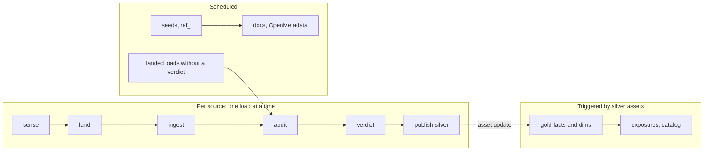

- Each silver table is an Airflow asset. Gold runs when its silver assets change, not inside every load.
- Sources run in parallel; one source never runs two loads at once. Models shared by sources (a fact joining two
  silver tables) run in the downstream DAG, so two loads never build them at the same time.
- Cosmos renders the dbt runs as tasks: one task group for the audit, one for publish.

## 10. Warehouse

The engine is chosen by volume and kept replaceable.

| Volume | Engine |
|---|---|
| Small, one machine | Postgres, or DuckDB on the landing zone |
| Large, managed | Snowflake, BigQuery, Databricks |
| Large, open | Iceberg tables on object storage, with Trino or Spark |

To keep the move an adapter change:

- dbt cross-database macros (`dbt.type_*`, `dbt.date_trunc`, `dbt_utils`) over engine-specific SQL.
- No queries on the engine's catalog; physical design in model config.
- Identifiers generated by the pipeline (`row_id` as uuidv7 in ingestion), not by database defaults.
- Bulk loading through files (parquet) rather than row inserts.

## 11. Quality and observability

- dbt tests and Elementary for the audit, as today. Enforced contracts on gold, the models others read.
- OpenLineage from Airflow and dbt, for lineage across tasks.
- Alerts from Airflow on refused, quarantined and failed loads.
- CI on every pull request: `dbt build` of the changed models and what depends on them, deferring to prod for the rest.

## 12. Roles

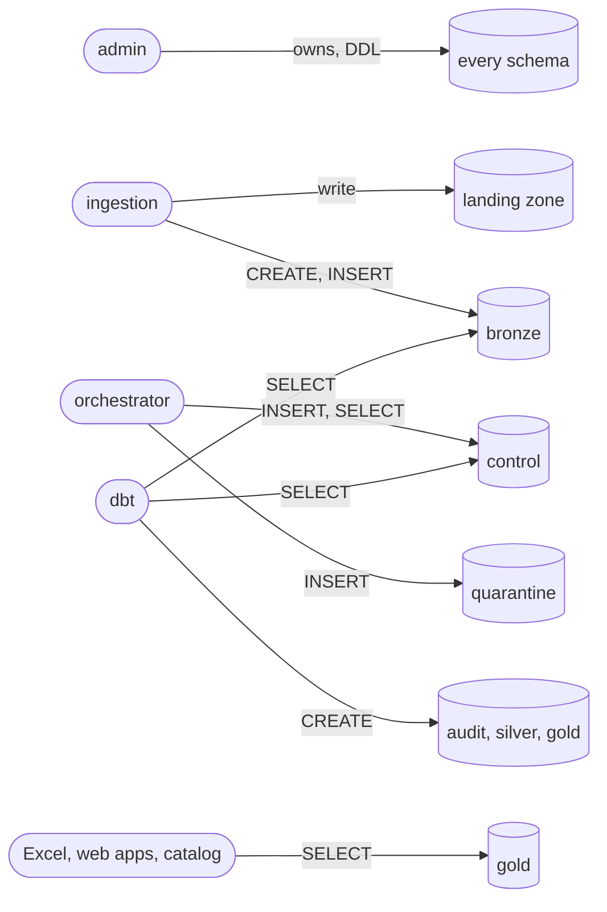

## 13. What goes away

| Today | Replaced by |
|---|---|
| Csv read from a mounted folder, nothing kept but bronze | Landing zone, every delivery kept with its checksum |
| A file sent twice loads twice | Checksum recognised, `duplicate` |
| Bronze DDL written per dataset | dlt creates it, under the source's schema contract |
| `row_id` from a database default | Generated in ingestion |
| No source row number | `source_row_number` in bronze |
| Row count and empty file as dbt source tests | Delivery checks in ingestion |
| `load_id` var in the staging view, a build failing on purpose without it | The audit selects its loads; no view holds an id |
| dbt skip-on-failure as the gate, `-- depends_on: ref_*` | The verdict in `control.loads` |
| Tests reading silver from the graph | Plain `ref`: audit and publish are separate runs |
| Retries off | Idempotent steps, retries on |
| `aud_issues` load from `invocation_vars` | Join `control.loads`; audit is observability only |
| Silver `full_refresh: false`, not rebuildable | Replay from bronze and the control table |
| Snapshots | History from bronze by load |
| `unique_key_index` post-hook on `pg_index` | `indexes` model config |
| Gold rebuilt in every load, two loads can collide on a fact | Gold triggered by silver assets, incremental |
| Bootstrap build, a whole build that fails on purpose | Scheduled refresh of seeds and `ref_` |

## 14. Migration, one step each

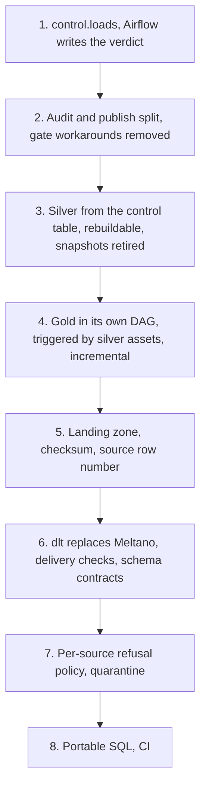

Each step leaves a working pipeline. Steps 1 to 4 change no source; 5 to 7 change how data arrives; 8 makes the
warehouse replaceable.

## Open decisions

- Ingestion: dlt, or keep Meltano (step 6).
- Landing zone: MinIO self-hosted, or a cloud bucket.
- Where quarantined rows are reviewed, and by whom.
- `control.loads` in the warehouse, or a separate operational database.

## SIMPLIFIED IMPLEMENTATION

The minimum that keeps the main idea: Airflow records whether each load passes, and nothing reaches silver without a
pass. Postgres, Meltano and dbt stay. Everything else waits.

### What is built

- **`control.loads`** in the warehouse, one row per event, written only by Airflow: `load_id`, `source`, `state`,
  `recorded_at`. A load's state is its latest event.
- **Four states**: `landed`, `accepted`, `refused`, `published`. A load that fails is refused whole; the file is fixed
  where it came from.
- **One DAG per source**, `max_active_runs=1`, retries off.
- **Audit models** over bronze, selecting the loads whose state is `landed`. No view holds a `load_id`, no `--vars`.
- **Silver incremental**, merging the `accepted` loads not yet `published`, in `load_id` order, by business key.
- **Gold built inside publish**, in an Airflow pool of 1, so two sources never build a shared fact at once.
- **A manual setup DAG**: `dbt build` of seeds, `ref_` models, dims, and Elementary's tables.
- **dbt run as plain commands** (BashOperator).

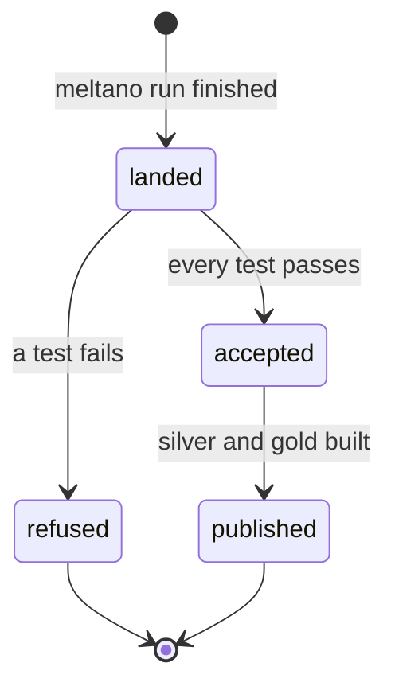

### The DAG

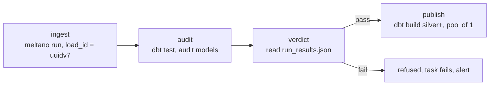

1. **ingest**: `meltano run tap-csv-<dataset> target-postgres` with `MELTANO_RUN_ID` set to a new uuidv7. Writes
   `landed`.
2. **audit**: `dbt test --select <the source's audit models>`. Its exit code is ignored; the verdict reads the results.
3. **verdict**: reads `target/run_results.json`. Every test passes: writes `accepted`. A test fails: writes `refused`
   and fails the task, so the Airflow failure alert is the notification. An error in dbt fails the task with no event:
   the load stays `landed`, to be rerun by hand.

   `run_results.json` is dbt's own artifact, so the verdict does not depend on Elementary. Elementary's `on-run-end`
   hook runs inside the same `dbt test`, though: the verdict reads only the test entries and ignores the exit code, so
   a failing hook cannot change it. **To revisit and confirm when implementing**: that `run_results.json` is complete
   when the hook fails, or else turn Elementary's hooks off for the audit run.
4. **publish**: `dbt build --select <the source's silver models>+`, the dbt build of silver and everything after it.
   Writes `published`.

### Removed

- The `load_id` var in staging, and the build that fails on purpose without it.
- `-- depends_on: ref_*` and dbt skip-on-failure as the gate.
- The bootstrap build that fails on purpose (replaced by the setup DAG).
- Snapshots.

### Build order

1. `control.loads` DDL.
2. Audit models selecting from `control.loads`; the staging var and gate workarounds removed.
3. Silver incremental from `control.loads`; snapshots removed.
4. The setup DAG.
5. The per-source DAG: ingest, audit, verdict, publish.
6. One source end to end: a good file reaches gold, a bad file is refused and never reaches silver.

### Later

Reviewed after the simplifications in As built (every run ends its load, one row per load), most useful first.

| What | Why it still matters | Section |
|---|---|---|
| Retries on `audit` only | Views and tests only, safe to rerun; the failure callback runs after the last try, so a blip no longer refuses a good file. `ingest` stays without: a retry loads the rows twice | 1, 4 |
| `source_row_number` | A refused file is fixed at the source: the line, not only the value | 6 |
| Silver rebuild from the published loads; history from bronze | Silver cannot be rebuilt (`full_refresh: false`), and without snapshots a row's history is only in bronze and `ctl_loads`. Needs its own path: staging holds the open load only | 6, 8 |
| Landing zone, checksum, `duplicate` | A file sent twice loads twice: harmless to silver (merge by business key), kept twice in bronze | 4, 6 |
| Delivery checks before bronze, `rejected` | Encoding, header and shape faults (`SampleData/drip_drain_csv/malformed_csv`) are not all caught | 3, 5 |
| `indexes` model config instead of the `pg_index` post-hook | Cleanup of `unique_key_index` | 8, 13 |
| OpenLineage, OpenMetadata, CI | OpenMetadata is planned; CI catches a broken build before a merge | 11 |
| Roles | Everything runs as one user | 12 |
| Portable SQL, a replaceable warehouse | What was added is portable already | 10 |

Open decisions:

| What | Section |
|---|---|
| An issues view for people, joined to `ctl_loads`: only when someone other than the developer reads failures (`aud_issues` was removed) | 13 |
| dlt, schema contracts | 7, 14 |

Dropped:

| What | Why |
|---|---|
| Scheduled pick-up of landed loads without a verdict | Every run ends its load (As built) |
| Quarantine, per-source refusal policy | A failing load is refused whole and fixed at the source |
| Gold in its own DAG, triggered by silver assets | The `publish` pool keeps two publishes apart, and gold builds in seconds |

### As built

Steps 1 to 6 done on `feature-airflow`. `control.loads` is `dw_control.ctl_loads`, after the naming standard.

**Every run ends its load**, so a dataset has at most one open load (`landed` or `accepted`). Staging holds that load
only: the data tests judge it while it is `landed`, silver reads it once it is `accepted`. A database outage between a
dbt step and its state write can still leave a load open, so every run starts with `no_open_load`: it fails, before
anything is loaded, when the dataset has a `landed` or `accepted` load. A person ends that load in `ctl_loads`, `refused`
or `failed`, and the file is sent again.

**`ctl_loads` holds one row per load, its current state**, updated in place, not one row per event. The path a load
took is in Airflow's run history, its rows in bronze. The audit's exit code
is the verdict: any failure, a failed test or an error of dbt, refuses the load, and the file is sent again. A failed
publish ends the load as `failed`, a fifth state, for a person to look at. `refused` and `failed` are written by the
failing task's failure callback.

**dbt runs through Cosmos**, not as plain BashOperator commands: `audit` and `publish` are Cosmos task groups
(`DataWarehouseAirflow/dags/utils/dbt_task_group.py`), one Airflow task per dbt node, each a `dbt build` of that node
and its tests, so the UI shows which model or test refused or failed the load. The tasks are drawn from the dbt
manifest, not from `dbt ls`: Airflow's manifest, in `/dbt-state/<RELEASE>/airflow-manifest` of the `dbt-state`
volume, written only by `airflow-init` on every `up`. Every other dbt command has a target of its own, so none
rewrites it under a running load. A model added since the last refresh has no task. The failure
callback is on every task of the group; the tasks after a failed one end `upstream_failed`, which runs no callback.
The `publish` pool is taken per node, not per publish: two datasets' publishes can take turns between nodes, but never
build the same node at once. What no load builds, the seeds, the `ref_` models, the dims over them and Elementary's
tables, is not a DAG: the setup scripts end with one plain `dbt build --selector setup` (`selectors.yml`), with
cautious indirect selection, so staging's tests, which read `ref_` models, are left to a load's audit. One dbt process
creates each schema once: Cosmos tasks starting at once on a new database raced to create the same schema.

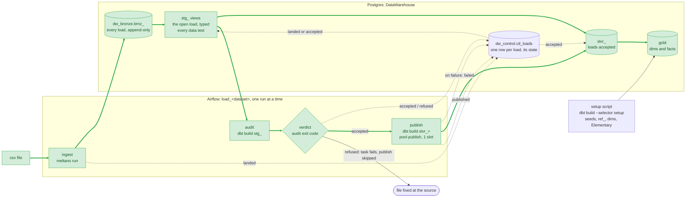

| Piece | Where |
|---|---|
| `dw_control.ctl_loads` | `Database/01_create_schemas_and_tables.sql` |
| Loads in a state | `macros/loads_in_state.sql` |
| `stg_<dataset>`: the open load, typed, every data test, row counts included | `models/staging/` |
| `slvr_<dataset>`: the accepted load | `macros/select_accepted_loads.sql` |
| The load dag: no_open_load, ingest, landed, audit, accepted, publish, published | `DataWarehouseAirflow/dags/load_datasets.py` |
| The setup build, its dbt selection, run by the setup scripts | `DataWarehouseDbt/selectors.yml`, `docker/02_setup_dev.ps1`, `docker/03_setup_prod.ps1` |
| A dbt build as a Cosmos task group, drawn from the manifest | `DataWarehouseAirflow/dags/utils/dbt_task_group.py` |
| Gold's keys, by hand, for its readers: every key test with dbt_constraints on, which adds every missing key | `DataWarehouseAirflow/dags/refresh_metadata.py` |
| The `publish` pool | `airflow-init` in `docker/compose.yaml` |

Removed: the `load_id` var, `-- depends_on: ref_*`, the bootstrap build that fails on purpose, snapshots (tables
dropped), `aud_issues` and `dw_audit`, and the source row-count tests (now on `stg_`).

Tested end to end on `journal_entries`: a good file went landed, accepted, published and reached gold; a file with a
bad `ph` and an unknown device was refused on those two tests, and silver and gold did not change. Not yet tested
through the DAG: `plants_batches`, whose publish rebuilds `dim_plants_batches` and `fct_journal_entries`.
