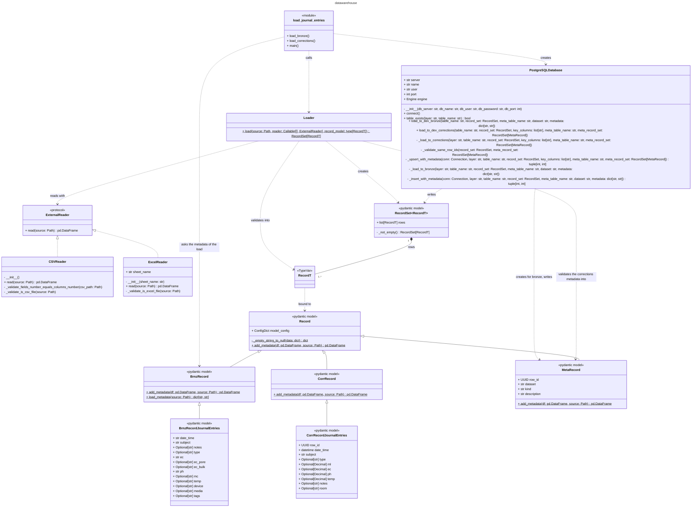

# Class diagram

The classes and generic types of `src/datawarehouse`, each class with all its attributes and methods, plus the one module that has functions of its own. Read it from top to bottom: the script that starts a load is at the top, the `Loader`, the readers and the database are below it, and the records that describe one row are at the bottom, with one base class per layer and one record for a row of a meta table. `config.py` and every type that comes from a library or from Python itself are left out.

## Legend

- **`<<module>>`:** a module that has functions of its own, drawn as a box with those functions. A module that only holds a class is not drawn.
- **`<<pydantic model>>`:** a class that inherits from pydantic's `BaseModel`, directly or through `Record`. Pydantic validates every object of the class when it is created.
- **`<<protocol>>`:** a `Protocol`. It describes the methods a class must have, and no class needs to inherit from it.
- **`<<TypeVar>>`:** a generic type, a placeholder for one specific class.
- **`+` and `-`:** a public member, and a member whose name starts with an underscore.
- **Underlined method:** a `@staticmethod` or a `@classmethod`.
- **Solid line with a hollow arrowhead:** the lower class inherits from the upper one.
- **Dashed line with a hollow arrowhead:** the lower class has the methods the protocol above it asks for.
- **Line with a filled diamond:** the class at the diamond holds objects of the other type. The numbers say how many: one `RecordSet` holds one or more rows.
- **Dashed line with an open arrowhead and a label:** the upper box uses the lower one in the way the label says.
- **Not drawn:** `config.py`, and the types from the standard library and from installed libraries. Their names appear only as the type of an attribute, a parameter or a return value.
