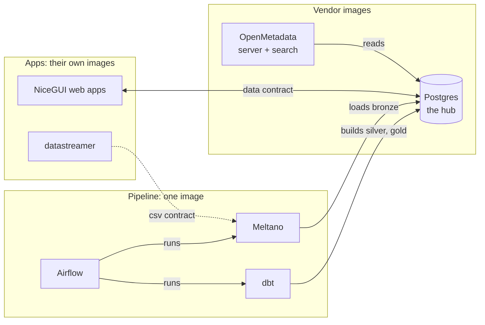
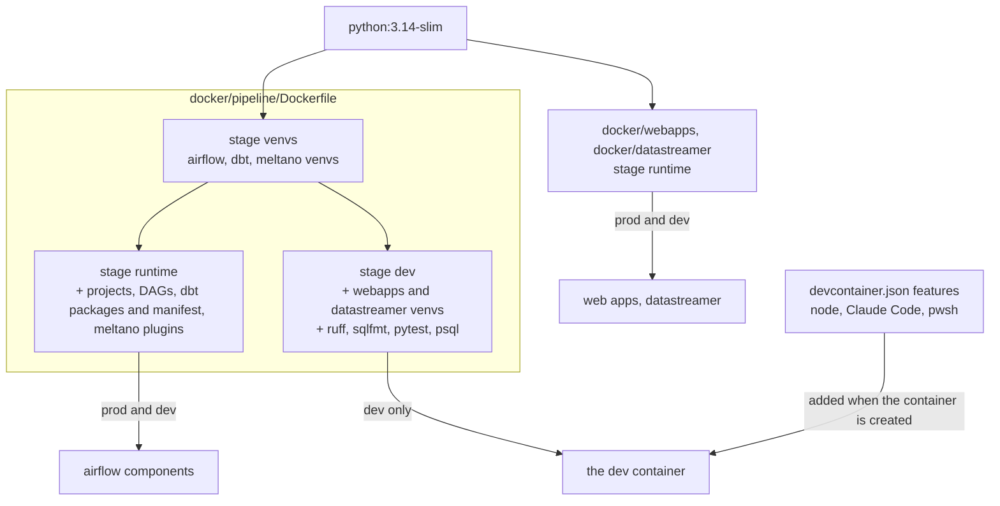

# Images, environments and the dev container

How the warehouse is cut into images, how dev is kept apart from prod, and why the dev container looks the way it does.
This is the reasoning behind `docker/`. The files themselves carry the details.

## Implementation plan

The steps from today's `docker/` to the design in sections 1–9. One step at a time, on a `feature-*` branch: make the
change, run its check, report, and wait before the next. Docker commands are run on Windows. Each step also updates
every doc and comment it makes wrong (`CLAUDE.md`, `docs/INSTALLATION_GUIDE_DOCKER.md`, the comments in `docker/`, the
DAGs and `devcontainer.json`), and strikes itself out here. When every step is done, this section is deleted.

The new-database problems in `docs/REMINDERS.md` were worked around once in dev, so the full check ("one load ends
`published`") works on dev's current database. A new dev database would need the same workaround, or the fix.

1. ~~**Rename the pipeline image.**~~ Done. `git mv docker/airflow docker/pipeline`, and the image `airflow:${RELEASE}` becomes
   `pipeline:${RELEASE}`. The `airflow-*` service names stay: each one is an Airflow component. Places that name the
   folder: `compose.yaml`, the Dockerfile's `COPY` lines and its `.dockerignore`, `docker/dev/Dockerfile`, the comments
   of the requirements files, `devcontainer.json`, the DAG comments (`setup_warehouse.py`, `utils/dbt_task_group.py`,
   `utils/gold_keys.py`), `02_setup_dev.ps1` and `03_setup_prod.ps1`, `docs/INSTALLATION_GUIDE_DOCKER.md`.
   - Prod: its release (`v0.6.1-alpha`) is from before Airflow, so it never had an `airflow:` image. It gets `pipeline:`
     with its first Airflow release.
   - Check: `git grep docker/airflow` finds only history notes; the build and `up` succeed; the DAGs show in the UI; one
     load ends `published`. The old `airflow:*` images are removed by hand. Passed 2026-11-16, after dev's database was
     fixed by hand (`docs/REMINDERS.md`): both loads ended `published`.
2. ~~**Move the dev tools' requirements**~~ Done: into the pipeline's folder: `docker/dev/requirements.txt` becomes
   `docker/pipeline/requirements-tools.txt`, `docker/dev/requirements-test.txt` becomes
   `docker/pipeline/requirements-test.txt`. Update `docker/dev/Dockerfile`, `pyproject.toml`, `devcontainer.json`, and
   the requirements line of `CLAUDE.md`.
   - Check: the dev container rebuilds; `ruff --version` and `pytest --version` are unchanged. Passed 2026-11-16.
3. **Split the pipeline Dockerfile into `venvs` and `runtime`**, with no change to what prod gets. `venvs`: the base
   image, git, the three venvs and their env vars. `runtime`: `FROM venvs`, then the projects, `dbt deps`, `dbt parse`,
   `meltano install`, `WORKDIR` and `ENTRYPOINT ["airflow"]`. Compose still builds `target: runtime`.
   - Check: the build and `up` succeed; one load ends `published`.
4. **Make the dev container a stage of the pipeline image.** `FROM venvs AS dev` in `docker/pipeline/Dockerfile`, with
   what `docker/dev/Dockerfile` adds today: the apt packages (psql at the server's major), the webapps, datastreamer
   and tools venvs, pytest in the webapps venv, `PATH` with the webapps venv first, and the env vars (`LANG`,
   `PYTHONPATH`, `AIRFLOW_HOME` and the rest). `ENTRYPOINT ["airflow"]` is set in `runtime` only, so `dev` does not
   inherit it; its `CMD` stays `sleep infinity`. The pipeline's `.dockerignore` lets through
   `docker/webapps/requirements.txt` and `docker/datastreamer/requirements.txt`. The `dev` service in `compose.dev.yaml`
   builds `docker/pipeline/Dockerfile` with `target: dev`, and the image keeps the name `dev:dev`: it is the
   toolbox, not the pipeline. `docker/dev/` is deleted.
   - Check, in the rebuilt dev container:
     - `which` finds `python`, `dbt`, `meltano`, `airflow`, `ruff` and `pytest` in the same venvs as before.
     - `dbt --version` and `meltano --version` match the scheduler's; `psql --version` matches the server's major.
     - `airflow dags list` reaches dev's Airflow database; `pytest` passes.
     - Dev still picks up changes live: an edited DAG shows in the UI without a rebuild; a new dbt model gets its task
       after `dbt parse` in the dev container; Cosmos tasks running at once do not share the `dbt-state` volume's
       `target` and `logs`.
     - One load ends `published`.
5. **Write the apps' contract as exposures.** One exposure per app in the dbt project, `depends_on` the models it reads,
   and a rule in `docs/CODING_STANDARDS.md`: an app that starts reading a model adds it to its exposure.
   - Check: `dbt ls --select +exposure:webapps` lists what the web apps read; `dbt build` is unaffected.
6. **Give dev and prod their own input and output folders.** Four Windows folders, none inside another; their paths are
   the user's choice. Update `USER_INPUT_DIR` and `USER_OUTPUT_DIR` in `.env` and `.env.prod`, and the template and
   comments of `01_setup_env.ps1` ("the same files as dev"). The files are moved by the user.
   - Check: `docker compose config` of each environment shows its own folders; a dev load reads dev's folder only; a dev
     datastreamer run writes to dev's folder only.
7. **Bring in OpenMetadata** from `feature-openmetadata`, in two steps.
   - 7a. The server and search in `compose.yaml` under the profile `openmetadata`, its database script, its port per
     environment, `PIPELINE_SERVICE_CLIENT_ENABLED=false`. Check: `--profile openmetadata up` starts it in dev; the UI
     opens.
   - 7b. Ingestion: an `openmetadata` venv in the `venvs` stage (on the branch it was in the dev image only), and a DAG
     that runs `metadata ingest`. Check: the DAG fills the catalog with the warehouse's tables and the dbt lineage.

Left for later: the env vars listed twice in `compose.dev.yaml` (the `env_file` idea).

## 1. The rule: group what changes together

An image boundary follows **coupling** and **change rate**. Parts that are tightly coupled and change together share an
image. Parts that change on their own schedule get their own image. Parts made by someone else stay in that vendor's
image, unchanged.



| Group | What | Coupling | Changes | Image |
|---|---|---|---|---|
| **Pipeline** | Airflow, dbt, Meltano (and later OpenMetadata ingestion) | Tight: the DAGs are drawn from the dbt manifest, the tasks call dbt and Meltano | Together, often | one image (`docker/pipeline`) |
| **Apps** | NiceGUI web apps, datastreamer | Loose: only through data contracts | Often, on their own | their own images (`docker/webapps`, `docker/datastreamer`) |
| **Hub** | Postgres | Everything depends on it | Rarely, as a planned event | vendor (`postgres:18`) |
| **Vendor apps** | OpenMetadata server and search | Reads the hub, nothing depends on it | On the vendor's schedule | vendor images, never rebuilt; in `compose.yaml` under the profile `openmetadata` |

## 2. Pipeline: orchestrator and tools in one image

Airflow runs with the **LocalExecutor**: the scheduler runs every task itself, as a child process. There is one machine,
the volumes are small, and Cosmos makes one task per dbt model, so a container per task would cost a container start per
model. So the tools a task calls live in the scheduler's image.

Inside that image each tool has **its own venv** under `/opt/venvs/`. Airflow installs against its constraints file,
which would otherwise force its versions on dbt and Meltano. Meltano then keeps one venv per plugin under `.meltano/`.
A venv isolates Python libraries. An image isolates everything else. A tool that needs neither more than a venv stays in
the pipeline image.

The scheduler is allowed more privilege than an ordinary service, because orchestrating is its job. Running tasks as
containers through the Docker socket stays possible. It is not used, because it adds start-up time and the wiring of
mounts and env vars to every task, not for reasons of privilege.

## 3. Apps: their own release cycle, bound by contracts

The warehouse runs without the apps. An app changes more often than the pipeline, and a change to one rarely needs the
other. So apps are built, versioned and released on their own cycle.

**For now all images share one version**: the git tag in `RELEASE`. That is a convenience, not a coupling. It answers
"which pipeline does this app work with" for free. The apps are tied to the warehouse only by data contracts, and the
release cycles can split whenever that is useful.

| Contract | Direction | What it is | Broken by |
|---|---|---|---|
| **Warehouse → apps** | apps read, and sometimes write | the gold (and `dw_control`) tables and views an app uses | a dbt change that renames, drops or retypes one of them |
| **Datastreamer → warehouse** | the datastreamer is a data source | the csv it writes, which a Meltano tap reads like any other input | a change to the csv's columns or format |

A change on either side of a contract is a change to both, and is checked as one.

The warehouse → apps contract is written down in the dbt project as **exposures**: one per app, listing the models it
depends on. `dbt ls --select +exposure:<app>` lists everything an app relies on, and the dbt docs draw the apps at the
end of the lineage, so a dbt change that touches a contract shows before it is built.

The datastreamer → warehouse contract is the dataset's input definition, as for any source: where the tap reads the file
and the entity it loads into (`DataWarehouseMeltano/meltano.yml`), and the columns, types and data tests in
`stg_<dataset>.yml`. A csv that breaks it is refused at the audit, like any other bad file.

## 4. OpenMetadata: a vendor app inside our projects

OpenMetadata's server and search engine are services in `compose.yaml` under the profile `openmetadata`: a plain `up`
does not start them, `--profile openmetadata` does. Inside `dw-dev` and `dw-prod` they reach postgres by its service
name and get the same dev and prod separation as every other service. Their own database lives on our postgres, and
the bundled ingestion Airflow is not used: ingestion is the `metadata` command in its own venv in the pipeline image,
run by our Airflow. Upgrading OpenMetadata is changing its image tag.

## 5. Postgres: the hub

Every party meets in the warehouse database: the pipeline writes it, the apps read it, OpenMetadata catalogues it, Excel
reports from it. Each speaks SQL against the contract schemas. **The contract is the schemas, not Postgres itself:** the
stack is Postgres-specific (dbt-postgres, Elementary, `timestamptz`), so the hub is shared, not vendor-neutral.

The same server has a second, unrelated role: it **hosts each tool's own metadata**, the `airflow`, `meltano` and later
`openmetadata` databases. That is only a convenience, one server instead of several. No party reads another tool's
database.

A role per party is what will make the contracts enforced rather than agreed: an apps role that sees only the contract
schemas. Until the roles exist, every service connects as `postgres`.

## 6. The dev container: one window, for convenience only



What the dev container needs is split by who installs it. The **dev stage** (built by Docker) holds what scripts and
tools run on: the venvs, the dev tools, psql. The **features** in `devcontainer.json` (added by VS Code when it creates
the container) hold what only the editor session needs: node and Claude Code, pwsh for the PowerShell extension.

A VS Code window attaches to one container, so working on everything in one window means one container with every tool.
The dev container is that container: a **toolbox**, not a deployed monolith. It runs nothing for the services, prod
never uses it, and it owns no version. Every venv in it is installed from the runtime images' requirements files.

It is built **from the pipeline image's `venvs` stage**, the same stage prod's `runtime` is built from. So the part that
is hard to get right (Airflow with dbt and Meltano under Airflow's constraints) is the exact prod build. It does not
take `runtime` itself: the projects baked in there are hidden by the repo mount anyway, and a change to a dbt model
would otherwise rebuild the whole dev image. The app venvs are added from the apps' requirements files, which is all
the parity those simple environments need.

**Front-end work happens here too, purely for convenience.** Sharing a window says nothing about coupling: the apps keep
their own images and release cycle, and their only link to the pipeline is the contract. A separate dev container for
the apps, attached to an apps dev stage, would fit the design just as well. It would cost a second window and a second
Claude Code workspace.

Everything the dev stage installs is under `docker/pipeline/`, the dev tools' requirements files included, so one folder
holds the whole recipe of the pipeline image and its dev stage. Dev-only files there never reach prod: a file is in an
image only if the stage being built copies it, and prod builds `runtime`, which never copies them. For the same reason the pipeline's
`.dockerignore` lets through the apps' requirements files, which only the dev stage copies.

Rules that keep the dev container honest:

- **The same mounts and env vars as the services**, so a load, a build or a reading behaves as it does in a service.
  YAML anchors cannot cross files, so the dev service's env vars are listed again in `compose.dev.yaml`. A new env var on
  a service is added there too.
- **psql at the server's major version.** `psql`, `pg_dump` and `pg_restore` come from PostgreSQL's own package source
  as `postgresql-client-<major>` in the dev stage, because Debian ships only its own major. The major is written in two
  places, there and in the `postgres:<major>` tag in `compose.yaml`, and the two change together.
- **No Docker inside.** It reaches the dev database and nothing else of Docker. Restarts and `docker volume` commands
  run from Windows.
- **Claude Code runs inside it**, with `CLAUDE_CONFIG_DIR=/claude-config`. Its memory is filed under the workspace path
  (`/usr/app`), so `workspaceFolder` never changes.

## 7. Dev and prod

One base `compose.yaml` holds every service once. `compose.dev.yaml` and `compose.prod.yaml` add only what differs, so
the difference between the two environments is visible in two small files.

| | Dev | Prod |
|---|---|---|
| **Compose project** | `dw-dev`: own containers, network, volumes | `dw-prod` |
| **Env file** | `docker/.env` | `docker/.env.prod` |
| **Git** | `dev`, `feature-*`, `hotfix-*` | `main`, the tag in `RELEASE` |
| **Code** | the repo bind-mounted at `/usr/app`, live | baked into the image, nothing mounted |
| **Postgres** | own container, `pgdata` volume, port; restores prod dumps from `/dumps` (read only) | own container, `pgdata` volume, port; writes the dumps |
| **Database access** | the dev credentials | the prod credentials. Dev could reach prod's port, but the passwords differ |
| **Airflow** | own metadata db, logs volume, UI port, JWT secret; DAGs read live | own of each; DAGs from the image |
| **dbt** | `target`, `logs`, packages in the `dbt-state` volume | packages and manifest from the image; `target`, `logs` discarded with the container |
| **Meltano** | own system db; plugins in the `meltano-plugins` volume | own system db; plugins from the image |
| **Web apps** | own port; reload on save | own port; the released image |
| **Datastreamer** | own `work-in-progress` volume | own `work-in-progress` volume |
| **OpenMetadata** | own db, search volume, port, bot token | own of each |
| **Input folder** (`USER_INPUT_DIR`) | its own Windows folder | its own Windows folder, not inside dev's |
| **Output folder** (`USER_OUTPUT_DIR`) | its own Windows folder | its own Windows folder, not inside dev's |
| **Dev container, Claude Code, dev tools** | yes | never |

### Volumes

| Volume | Environments | Holds | Mounted at |
|---|---|---|---|
| `pgdata` | both | the database | `/var/lib/postgresql` |
| `work-in-progress` | both | what a program has not finished yet, one subfolder per program | `/work_in_progress` |
| `airflow-logs` | both | the task logs, written by the scheduler, read by the UI | `/opt/airflow/logs` |
| `dbt-state` | dev | `dbt_packages`, `target` (with the manifest the DAGs are drawn from), `logs` | `/dbt-state` |
| `meltano-plugins` | dev | the plugin venvs, shared by the scheduler and the dev container | `DataWarehouseMeltano/.meltano` |
| `claude-config` | dev | Claude Code's login, settings, skills, memory | `/claude-config` |

Every volume is prefixed by its project (`dw-dev_*`, `dw-prod_*`). All but `claude-config` are refilled from the repo or
the image. `claude-config` has to be carried (section 9).

## 8. What stays on Windows

- The repo, and the folders shared with the containers: the input and output folders of each environment, and
  `Database/dumps`.
- Docker Desktop, Excel, and VS Code with only the Dev Containers extension. The project is opened only in the dev
  container, whose extensions are listed in `devcontainer.json`.
- The OnePen bridge (`onepen_bridge.py` with bleak, started by `OnePen.cmd`), because the Bluetooth adapter is on
  Windows.
- The setup scripts `docker/0*_setup_*.ps1`.

## 9. Moving Claude Code to another machine

Volumes stay in this machine's Docker. Everything except `claude-config` is rebuilt or refilled from the repo. Run these
from Git Bash at the repo root, with the dev container closed:

```bash
# on the old machine: export the volume to claude-config.tgz in the current folder
MSYS_NO_PATHCONV=1 docker run --rm -v dw-dev_claude-config:/data -v "$PWD":/backup python:3.14-slim \
  tar czf /backup/claude-config.tgz -C /data .

# on the new machine, before opening the dev container: import it into a new volume
MSYS_NO_PATHCONV=1 docker run --rm -v dw-dev_claude-config:/data -v "$PWD":/backup python:3.14-slim \
  tar xzf /backup/claude-config.tgz -C /data
```

`claude-config.tgz` holds the login, so keep it out of git and OneDrive, and delete it once it's imported.
