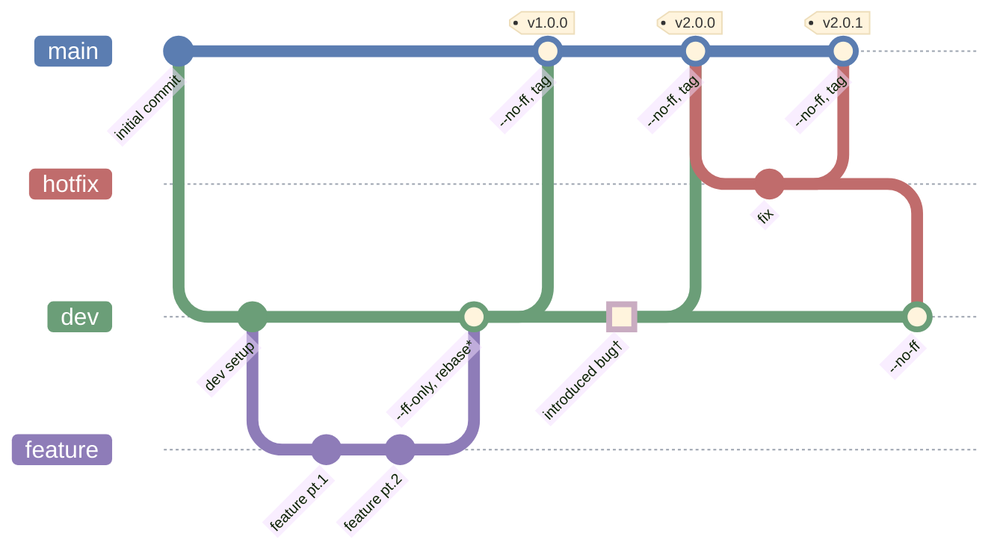
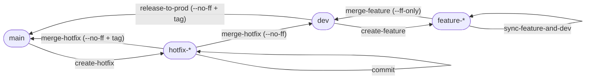

# Git Strategy

## 1. Philosophy

- **`main` only ever holds released code.** Every commit on `main`'s first-parent line is a release or a hotfix, tagged with its version.
- **`dev` is always releasable.** Work reaches `dev` only once it has been rebased onto the latest `dev` and tested there.
- **`dev` history stays linear.** Features are rebased and fast-forwarded, so `dev` reads as a straight list of changes. The only merge commits on `dev` come from hotfixes.
- **Shared history is never rewritten.** `main` and `dev` are never rebased or force-pushed.
- **A feature branch has exactly one owner.** Nobody else commits to it or branches off it, so its owner can rebase and force-push it freely.
- **All merges happen locally.** GitHub ([le1douglas/DataWarehouse](https://github.com/le1douglas/DataWarehouse)) stores the branches and enforces the rules; no merges are done through pull requests.

Problems this solves:

| Problem | How it is solved |
| --- | --- |
| Unclear what is in production | Tagged `--no-ff` merge commits on `main`, pushed only by the maintainer |
| Tangled history with merges everywhere | Rebase + fast-forward into `dev`; GitHub rejects merge commits on `dev` |
| Broken `dev` after a merge | Rebase and test *before* merging; `--ff-only` refuses stale branches |
| A rebase destroying someone else's work | One owner per feature branch; `--force-with-lease --force-if-includes` |
| Urgent fixes waiting for the next release | Hotfix branches off `main` |
| Fixes lost in the next release | Every hotfix is also merged into `dev` |

## 2. Roles

**The maintainer is `le1douglas`** (GitHub login and git `user.name`).

| Role | Who | Can run |
| --- | --- | --- |
| Maintainer | `le1douglas` | everything a feature owner can, plus `release-to-prod`, `create-hotfix`, `merge-hotfix` and `commit` on hotfix branches |
| Feature owner | whoever created the feature branch | `commit`, `sync-feature-and-dev` and `merge-feature`, on their own branch only |
| Anyone | everyone with push access | `create-feature` |

How to check:

```sh
# Who you are: must print le1douglas to act as maintainer
git config user.name

# Who owns a feature branch: the author of its commits. Exactly one name, and it must be yours.
# No commits yet means no owner yet: whoever runs the action takes it.
git log --format='%an' origin/dev..feature-name | sort -u
```

`user.name` is set by each person, so this check prevents mistakes, not intent. The real enforcement is the GitHub rulesets in section 6, which only let the maintainer push to `main`, push merge commits to `dev`, and create `v*` tags.

## 3. Branches

| Branch | Lifetime | Branches off | Merges into | Rewritten? | Who pushes |
| --- | --- | --- | --- | --- | --- |
| `main` | permanent | – | – | never | maintainer only |
| `dev` | permanent | – | `main` | never | everyone, fast-forwards only |
| `feature-name` | short | `dev` | `dev` | yes, rebased + force-pushed | its single owner |
| `hotfix-name` | short | `main` | `main` and `dev` | never | maintainer only |

- `main`: released code; every release and hotfix is tagged.
- `dev`: integration branch for the next release.
- `feature-name`: one feature or change; rebased, then fast-forwarded into `dev`.
- `hotfix-name`: urgent fix to released code.

No commits are made directly on `main` or `dev`. They only change through the actions below.

## 4. Overview

What the history looks like after two releases and a hotfix:



> Simplifications in this drawing:
> - \* `--ff-only, rebase` is a fast-forward, so in the real history the feature commits sit directly on `dev` with no merge commit. Mermaid can only draw it as a merge.
> - † The highlighted `introduced bug` commit stands for the work that lands on `dev` between `v1.0.0` and `v2.0.0`, including the bug that the hotfix later fixes. In reality it arrives through feature branches.

## 5. Actions

Every action and where it goes:



Changes only ever move along these arrows. The hooks in section 6 refuse any merge into a `feature-*` or `hotfix-*` branch.

Each action below is the complete list of commands, checks included. Lines marked ⚠ are where a merge conflict can stop you: resolve it, then carry on with the next command.

### create-feature

Anyone.

```sh
git checkout dev
git pull --ff-only
git checkout -b feature-name
git push -u origin feature-name
# work, then run commit as often as you like
```

### commit

On a feature branch, the feature's owner. On a hotfix branch, the maintainer only. Saves all your current changes on that branch and pushes them.

```sh
B=feature-name                # the branch: a feature-* or a hotfix-* branch
M="commit message"            # what this commit does

git checkout "$B"
git status --short            # everything listed here is committed: new, changed and deleted files
git add -A
git commit -m "$M"
git push
# Push rejected on a feature branch? You rebased without pushing.
#   Run sync-feature-and-dev, which force-pushes safely.
```

### sync-feature-and-dev

The feature's owner. Run this before every merge into `dev`, and whenever `dev` has moved on.

```sh
git checkout feature-name
git fetch
before=$(git rev-list --count origin/dev..HEAD)
git rebase origin/dev
# ⚠ CONFLICT POSSIBLE, commit by commit, wherever dev changed the same lines.
#   Resolve, then: git add <files> && git rebase --continue
#   During a rebase the sides are reversed:
#     "current" / "ours"     = dev
#     "incoming" / "theirs"  = your feature commits
#   Keep your change or combine both. Give up and go back: git rebase --abort

# Check that no commit was dropped (keeping only dev's side empties a commit)
after=$(git rev-list --count origin/dev..HEAD)
[ "$before" = "$after" ] || echo "STOP: $((before - after)) of your commits were dropped. Undo the rebase with: git reset --hard ORIG_HEAD"

# run the tests
git push --force-with-lease --force-if-includes
```

### merge-feature

The feature's owner, right after `sync-feature-and-dev`.

```sh
git checkout dev
git pull --ff-only
git merge --ff-only feature-name
# No conflicts: a fast-forward never conflicts.
# If it fails, dev has moved: run sync-feature-and-dev again and retry.
# Ignore Git's hint to use "git merge --no-ff": dev only takes fast-forwards.
git push origin dev
# Push rejected? Someone pushed to dev a moment ago. Undo your local merge with
#   git reset --hard origin/dev
# (your commits are still on feature-name), then rebase again and retry.
git branch -d feature-name
git push origin --delete feature-name
```

### release-to-prod

Maintainer only.

```sh
git checkout dev
git pull --ff-only
git checkout main
git pull --ff-only --tags     # also get every tag, so the version below follows the latest release
V=vX.Y.0                      # the new version
git merge --no-ff dev -m "Release $V"
# ⚠ CONFLICT should not happen: every hotfix is already in dev.
#   If it does, a hotfix was not merged into dev. Abort with
#   git merge --abort, merge that hotfix into dev, then retry.
git tag -a "$V" -m "Release $V"
git push --atomic origin main "$V"   # branch and tag together, or neither
```

### create-hotfix

Maintainer only.

```sh
git checkout main
git pull --ff-only
git checkout -b hotfix-name
git push -u origin hotfix-name
# fix, then run commit
```

### merge-hotfix

Maintainer only. The steps always run together and in this order: `main` first, so the release is fixed before anything else happens.

```sh
H=hotfix-name                 # the hotfix branch
V=vX.Y.Z                      # the new version (patch + 1)

# 1. Check that the hotfix contains only its own fix, no unreleased dev work
git fetch
[ "$(git rev-list --count "$H" ^origin/main ^origin/dev ^dev)" = "$(git rev-list --count "$H" ^origin/main)" ] \
  || echo "STOP: $H contains commits from dev. Do not continue."

# 2. Into main, tagged
git checkout main
git pull --ff-only
git merge --no-ff "$H" -m "Hotfix $V"
# ⚠ CONFLICT only if another hotfix landed on main in the meantime
#   and touched the same lines.
git tag -a "$V" -m "Hotfix $V"
git push --atomic origin main "$V"

# 3. Into dev
git checkout dev
git pull --ff-only
git merge --no-ff "$H" -m "Merge $H into dev"
# ⚠ CONFLICT LIKELY: dev has moved on since the release.
#   Resolve here, on dev: git add <files> && git merge --continue
#   Keep both the fix and dev's newer work.
git push origin dev

# 4. Clean up
git branch -d "$H"
git push origin --delete "$H"
```

Feature branches still in progress pick up the hotfix the next time they run `sync-feature-and-dev`.

## 6. Guardrails

### Git config (everyone, once per clone)

```sh
# Never create a merge commit by accident when pulling
git config pull.ff only

# Releases and hotfixes always create a merge commit on main
git config branch.main.mergeoptions "--no-ff"

# Plain merges into dev must be fast-forwards.
# The explicit --no-ff in the hotfix action overrides this.
git config branch.dev.mergeoptions "--ff-only"

# Make --force-with-lease also check --force-if-includes
git config push.useForceIfIncludes true

# Remove local copies of branches deleted on GitHub at every fetch or pull
git config fetch.prune true

# Remember conflict resolutions and replay them automatically
git config rerere.enabled true

# Show the common ancestor in conflict markers (easier to resolve)
git config merge.conflictStyle zdiff3

# Use the versioned hooks folder below
git config core.hooksPath .githooks
```

### Hooks

Two files in `.githooks/`, committed so everyone gets them. Make them executable when adding them: `git add --chmod=+x .githooks/*`. A `.gitattributes` line keeps them on LF line endings on every system:

```
.githooks/* text eol=lf
```

| Hook | Blocks |
| --- | --- |
| `pre-commit` | Direct commits on `main` or `dev`; finishing a conflicted merge into a `feature-*` or `hotfix-*` branch |
| `pre-merge-commit` | A conflict-free merge into a `feature-*` or `hotfix-*` branch |

`.githooks/pre-commit`:

```sh
#!/bin/sh
# Runs on every commit, including the one that finishes a conflicted merge.
branch=$(git symbolic-ref --short HEAD 2>/dev/null)
git_dir=$(git rev-parse --git-dir)

if [ -f "$git_dir/MERGE_HEAD" ]; then
    case "$branch" in
        feature-*|hotfix-*)
            echo "Merging into $branch is not allowed. Rebase feature branches onto dev; hotfix branches never receive merges."
            echo "Undo with: git merge --abort"
            exit 1 ;;
    esac
    exit 0
fi

if [ "$branch" = "main" ] || [ "$branch" = "dev" ]; then
    echo "Direct commits on $branch are not allowed. Use feature-* or hotfix-*."
    exit 1
fi
```

`.githooks/pre-merge-commit`:

```sh
#!/bin/sh
# Runs before a merge that completes without conflicts creates its merge commit.
branch=$(git symbolic-ref --short HEAD 2>/dev/null)

case "$branch" in
    feature-*|hotfix-*)
        echo "Merging into $branch is not allowed. Rebase feature branches onto dev; hotfix branches never receive merges."
        echo "Undo with: git merge --abort"
        exit 1 ;;
esac
```

Limits:
- A fast-forward creates no commit, so no hook runs. A fast-forward of `dev` into a hotfix branch is caught by the check in step 1 of the hotfix action instead.
- Anyone can skip the hooks with `--no-verify`. They prevent accidents, not intent.

### GitHub rulesets

#### Manually

In the repository: **Settings → Rules → Rulesets**. Add the maintainer (or the *Repository admin* role) to each bypass list with mode **Always**, so direct pushes are allowed, not only pull requests.

| Ruleset | Target | Rules | Bypass |
| --- | --- | --- | --- |
| `protect-main` | branch `main` | Restrict updates, Restrict deletions, Block force pushes | maintainer |
| `protect-dev` | branch `dev` | Restrict deletions, Block force pushes, Require linear history | maintainer |
| `protect-tags` | tags `v*` | Restrict creations, Restrict updates, Restrict deletions | maintainer |

- **`protect-main`**: only the maintainer can release.
- **`protect-dev`**: everyone can push fast-forwards. Only the maintainer can push merge commits, which is what step 3 of `merge-hotfix` needs. Nobody can rewrite or delete `dev`.
- **`protect-tags`**: release tags can't be created, moved or deleted by anyone else.
- Rulesets work on public repositories with a free account. A private repository needs GitHub Pro or Team.

#### With the GitHub CLI

The same three rulesets, created with [`gh`](https://cli.github.com/). Run in Git Bash, logged in as the repository owner (`gh auth login`). The bypass actor `RepositoryRole` 5 is the *Repository admin* role.

```sh
REPO=le1douglas/DataWarehouse

# Create the ruleset named $1 from the JSON on stdin,
# or replace it if a ruleset with that name already exists.
apply_ruleset() {
  id=$(gh api --paginate "repos/$REPO/rulesets" \
         --jq ".[] | select(.name == \"$1\") | .id" </dev/null)
  if [ -n "$id" ]; then
    echo "Updating $1 (id $id)"
    gh api -X PUT "repos/$REPO/rulesets/$id" --input - --silent
  else
    echo "Creating $1"
    gh api -X POST "repos/$REPO/rulesets" --input - --silent
  fi
}

apply_ruleset protect-main <<'EOF'
{
  "name": "protect-main",
  "target": "branch",
  "enforcement": "active",
  "conditions": { "ref_name": { "include": ["refs/heads/main"], "exclude": [] } },
  "rules": [
    { "type": "update" },
    { "type": "deletion" },
    { "type": "non_fast_forward" }
  ],
  "bypass_actors": [
    { "actor_id": 5, "actor_type": "RepositoryRole", "bypass_mode": "always" }
  ]
}
EOF

apply_ruleset protect-dev <<'EOF'
{
  "name": "protect-dev",
  "target": "branch",
  "enforcement": "active",
  "conditions": { "ref_name": { "include": ["refs/heads/dev"], "exclude": [] } },
  "rules": [
    { "type": "deletion" },
    { "type": "non_fast_forward" },
    { "type": "required_linear_history" }
  ],
  "bypass_actors": [
    { "actor_id": 5, "actor_type": "RepositoryRole", "bypass_mode": "always" }
  ]
}
EOF

apply_ruleset protect-tags <<'EOF'
{
  "name": "protect-tags",
  "target": "tag",
  "enforcement": "active",
  "conditions": { "ref_name": { "include": ["refs/tags/v*"], "exclude": [] } },
  "rules": [
    { "type": "creation" },
    { "type": "update" },
    { "type": "deletion" }
  ],
  "bypass_actors": [
    { "actor_id": 5, "actor_type": "RepositoryRole", "bypass_mode": "always" }
  ]
}
EOF

# Check the result
gh api "repos/$REPO/rulesets" --jq '.[] | "\(.id)  \(.name)  \(.enforcement)"'
```

The script is safe to run again: each ruleset is matched by its name and replaced with the JSON above, so it never creates duplicates. To change a rule, edit the JSON here and rerun the script. Changes made in the web UI are overwritten on the next run.

### Naming

| What | Format | Example |
| --- | --- | --- |
| Feature branch | `feature-name` | `feature-login` |
| Hotfix branch | `hotfix-name` | `hotfix-crash-on-start` |
| Release tag | `vX.Y.0`, annotated | `v4.0.0` |
| Hotfix tag | `vX.Y.Z`, annotated (patch +1) | `v4.0.1` |

## 7. Remember

What no command, hook or ruleset can enforce:

- **As maintainer, GitHub doesn't stop you.** Your bypass covers force pushes and deletions too. Never force-push `main` or `dev`.
- **Never move or delete a pushed tag.** If a release is wrong, release a new version.
- **`dev` must stay releasable.** There is no CI yet: test before every `merge-feature`.
- **Only the maintainer can release or hotfix.** If the maintainer is away, both wait.
- **One owner per feature branch.** Don't commit to someone else's feature branch or branch off it; wait until it is in `dev`.
- **Set up every new clone.** Git config and `core.hooksPath` are not cloned: run the config block in section 6 on every machine.
- **When something goes wrong:** `git merge --abort` or `git rebase --abort` gets you back to the start, and `git reflog` finds commits that seem lost.