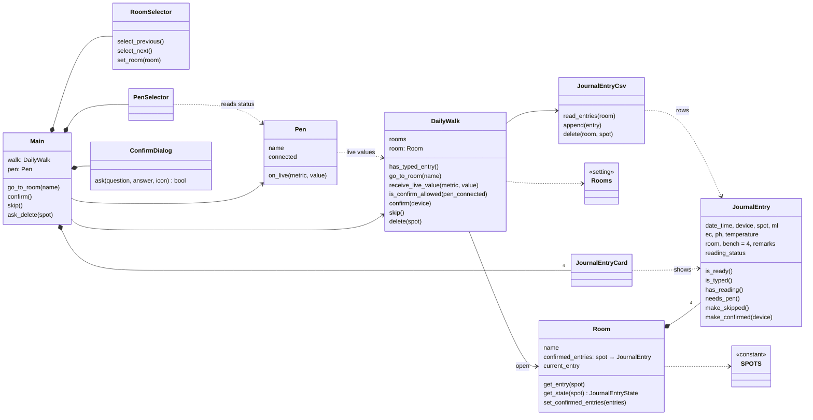
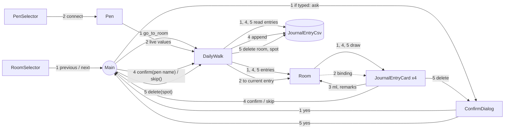

# Drip drain web app: structure

The objects of the app, what each one does, and how data moves between them. The diagrams are Mermaid: they render on GitHub, and in VS Code with the Markdown Preview Mermaid Support extension.

## Conceptual map

| Element | Kind | Role |
|---|---|---|
| DailyWalk | logic | The walk through the rooms (glossary: daily walk). It holds the open Room and does every read and write of the csv. It decides when a confirm is allowed and whether a move to another room would lose a typed entry. It knows nothing of the UI or the pen: Main passes it `pen.connected` and `pen.name`. |
| Room | data | The 4 JournalEntries of one room, one per spot, as DailyWalk gives them. It decides which spot is current: the first one without a confirmed entry. It knows nothing of the csv. |
| JournalEntry | data | One reading and its metadata: `date_time, device, spot, ml, ec, ph, temperature, room, bench, remarks, reading_status`. `bench` is always 4. It is what a JournalEntryCard shows and the entry being measured, and it holds the rules of what an entry needs. It starts as `measured`, until the user skips it. Confirming makes a copy as it is written, so the entry is unchanged when the write fails; the copy keeps only what it holds: a skipped one has no ml, live values or device. It knows nothing of the csv. |
| JournalEntryState | data | Derived for each JournalEntry: `pending` (not reached yet), `current` (being measured), `confirmed` (in the csv). It decides how the card looks. This is not `reading_status`. |
| Spot | constant | `SPOTS = ("drip_left", "drip_right", "drain_left", "drain_right")` in measuring order, in the csv form. The label on screen (`Drip Left`) is derived from it. `spot` is the source's name for the glossary's relative position. |
| Rooms | setting | `ROOMS`: the app's own ordered list of room names, the route walked. |
| JournalEntryCsv | storage | The one csv, keyed by (room, spot), which holds one daily walk. It reads the entries of a room, appends one and deletes one. It is the only record of confirmed entries, and the app's output. It owns the file's format: the columns, `n.a` for `None`, the decimals, `date_time` without its zone. It writes an entry as it is, without looking at its `reading_status`. |
| Pen | device | Sends live `ph`, `ec` and `temperature` values. It also owns its connection status, `connected` and `name`, which becomes `device`. The UI reads these and keeps no copy. It is `MockPen` now and will be a OnePen later. |
| JournalEntryCard | UI | Shows one JournalEntry as a card. For the current entry the user fills in `ml` and `remarks`, then presses Confirm, or Skip when the spot is not measured. `remarks` is optional: it may be left empty, and an empty value is written as an empty string. A confirmed skipped entry is greyed out. |
| RoomSelector | UI | Previous and next buttons that move through Rooms. It only asks Main for a room, and shows it once Main has moved there. |
| PenSelector | UI | Connect and Disconnect buttons and the pen status. |
| ConfirmDialog | UI | One yes or no dialog with its question set by Main. It asks before a confirmed entry is deleted. It also asks before a room change would discard a typed entry, meaning one where `ml` or `remarks` has been typed. Live values alone do not count, because the pen sends them again. |
| Main | UI | The entry point and its one page. It creates the DailyWalk, the Pen and the UI elements and wires them together. It asks, notifies and redraws; DailyWalk decides. |

`reading_status` is `measured` by default, and `skipped` when the user presses Skip: one press confirms the entry, with `ml` and the live values `n.a`, no device, and the remarks kept. Delete undoes it, as for any confirmed entry. The warehouse also accepts `unreliable`, which the app does not write for now: a reading with an `n.a` value cannot be confirmed, only skipped.

## Structure diagram

## Data flow diagram

1. **Room change**: RoomSelector → Main. If DailyWalk says the current entry is typed, ConfirmDialog asks whether to discard it, and "no" keeps the user in the room. Otherwise DailyWalk reads the new room's entries from the csv → a new Room, whose current entry starts empty → the cards are drawn again.
2. **Live values**: PenSelector connects the Pen. Pen → DailyWalk → the current JournalEntry of the open Room → its card through the binding.
3. **Typing**: the current card's `ml` and `remarks` are bound to the current JournalEntry.
4. **Confirm**: card → Main, which asks DailyWalk whether it is allowed, passing `pen.connected` → DailyWalk makes the confirmed copy, with `date_time` (in `TZ`) and `device` (the pen's name) → JournalEntryCsv.append → the Room's entries are read again and the next spot becomes current. **Skip** takes the same path, without asking about the pen: the copy is skipped, with no device.
5. **Delete**: card → ConfirmDialog → Main → DailyWalk → JournalEntryCsv.delete(room, spot) → the Room's entries are read again, and that spot is current again.

## Files
| Element | File |
|---|---|
| Main | `main.py` |
| JournalEntryCard | `ui/journal_entry_card.py` |
| RoomSelector | `ui/room_selector.py` |
| PenSelector | `ui/pen_selector.py` |
| ConfirmDialog | `ui/confirm_dialog.py` |
| DailyWalk | `state/daily_walk.py` |
| Room, SPOTS | `state/room.py` |
| Rooms (and the other settings: `BENCH`, `TIMEZONE`, `CSV_PATH`) | `settings.py` |
| JournalEntry | `state/journal_entry.py` |
| JournalEntryState | `state/journal_entry_state.py` |
| JournalEntryCsv | `state/journal_entry_csv.py` |
| Pen | `pens/mock_pen.py` |
